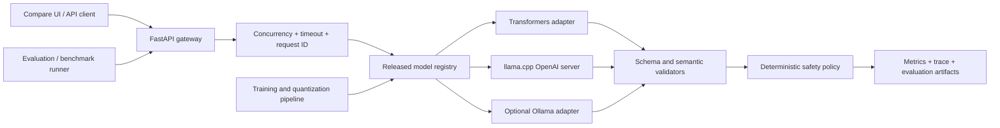

# ModelForge-TW 第一階段方向提案

> 本文件是實作前的歷史決策基線，刻意保留當時的「預定／尚未執行」描述。完成後的真實狀態與
> 數字請以專案 README、`docs/EVALUATION.md` 與 `docs/BENCHMARKS.md` 為準。

> 文件狀態：方向確認前提案，2026-08-28。
> 本文件只規劃公司實務版，未開始模型下載、資料集大量產生、訓練或正式效能測試。
> 文件不含目標雇主、職缺、客戶、私人資料或本機使用者路徑，可保留在公開作品中。

## 1. 建議結論

建議繼續製作，但把原本寬泛的「LLM 微調量化推論平台」收斂為：

**ModelForge-TW：繁中設備事件模型適配、量化與推論發布平台**

資料夾名稱維持既定的 `LLM 微調量化推論平台/公司實務版`。公開名稱增加
`ModelForge-TW`，讓讀者能在短時間內理解作品主軸。

這個作品要回答的不是「能不能呼叫一個模型」，而是：

1. 一個未修改的開源模型對繁中領域任務表現如何？
2. Prompt optimization 與 LoRA／QLoRA 各自帶來多少可量化改善？
3. INT4／INT8／GGUF 量化節省多少記憶體，品質付出多少代價？
4. 同一模型在 Transformers 與 llama.cpp 等引擎上的延遲、吞吐及資源差異為何？
5. 哪一個模型版本可以發布，失敗時如何安全回退？

### 為何需要調整使用情境

既有作品已經完整展示 RAG、Agent、SOP 檢索、工具執行、人工核准與設備事件調查。
新作品若再做「設備問答 Agent」會造成敘事重複。

因此新作品只處理模型適配問題：把凌亂的繁體中文操作員事件紀錄轉成固定 JSON，
不做知識庫檢索、不做自由工具呼叫、不執行設備控制。它可獨立展示，也可在未來成為其他
工作流的上游輸入正規化器。

## 2. 作品定位

| 項目 | 定義 |
|---|---|
| 主要使用者 | ML／AI 工程師、平台工程師、模型發布審核者、現場系統整合工程師 |
| 使用情境 | 將繁中設備告警、交班紀錄與操作員文字正規化為可驗證事件資料 |
| 問題 | 通用模型容易輸出不合法 JSON、遺漏高風險訊號、混用簡體中文或提出越權處置 |
| 輸入 | 操作員文字、可選資產類型、可選結構化量測訊號；不接受任意 URL 或檔案路徑 |
| 模型任務 | 事件類別、嚴重度、輸入證據片段、缺少資訊與安全下一步的結構化產生 |
| 系統任務 | Schema 驗證、證據子字串驗證、安全動作 allowlist、版本追蹤、效能量測與回退 |
| 輸出 | 模型版本、量化版本、推論引擎、結構化事件、驗證狀態、人工複核旗標與 trace ID |
| 失敗策略 | 無效輸出、timeout、低信心、未知事件或高風險一律保守回退並要求人工處理 |

### 預定輸出契約

```json
{
  "event_type": "mechanical | electrical | thermal | pressure | communication | process | unknown",
  "severity": "low | medium | high | critical | unknown",
  "summary_zh_tw": "繁體中文摘要",
  "evidence_spans": ["必須逐字存在於輸入的片段"],
  "missing_information": ["仍缺少的判讀資訊"],
  "safe_actions": ["observe | isolate_and_escalate | stop_and_escalate | collect_evidence"],
  "review_required": true,
  "reason_codes": ["HIGH_SEVERITY", "INSUFFICIENT_EVIDENCE"]
}
```

模型不能直接決定最終控制行為。伺服器會在模型輸出後套用確定性安全政策，例如任何
`critical` 結果必須 `review_required=true`，不在 allowlist 的自由文字動作不得交付。

### 明確不做

- 不做 RAG 聊天機器人或自由 Agent。
- 不控制 PLC、機台、雲端資源或外部工作流。
- 不把模型自報信心當成校準機率。
- 不把合成案例結果描述成實際產線安全認證。
- 不訓練基礎模型、不做新架構研究、不製作前沿研究版。
- 不在 Git 提交模型權重、大型資料集、執行結果資料庫或秘密。

## 3. 需要證明的工程能力

### 必備

- Python、PyTorch、Hugging Face Transformers／Datasets／PEFT。
- 固定種子、資料切分、洩漏檢查、checkpoint、設定與環境指紋。
- 未修改模型、prompt-only 與 PEFT 模型的公平比較。
- 至少一個 LoRA 或 QLoRA 真實訓練結果。
- 至少 BF16／FP16 與一個 INT4 GGUF 的真實品質及效能比較。
- Transformers 原生推論與 llama.cpp GPU 推論。
- OpenAI-compatible API、結構化輸出、streaming、timeout、並發控制與指標。
- 發布 gate、模型 registry、artifact SHA-256、previous-good 回退。
- Docker／Kubernetes 的可移植部署基礎與健康探針。
- 可重現測試、隱私檢查、Dataset Card、Model Card 與第三方授權說明。

### 加分

- Linux／WSL2 上的 vLLM 或 SGLang 實測。
- 不同並發量下的 continuous batching 比較。
- AWQ／GPTQ 或進一步量化方法。
- Kubernetes Job 訓練、GPU resource request、節點限制與 rollout／rollback 演示。
- 24GB 以上 GPU 的 8B 級模型比較。

### 不應勉強完成

- 在目前原生 Windows 環境宣稱跑過 vLLM、SGLang 或 TensorRT-LLM。
- 在 8GB 顯存上勉強訓練 8B 級模型並以不穩定設定換取漂亮截圖。
- 同時支援所有引擎，卻沒有任何一組可比較的實測證據。

## 4. 本機環境快照

以下為第一階段唯讀檢查結果，不是估算：

| 類別 | 實際狀態 | 對專案的影響 |
|---|---|---|
| 作業系統 | Windows 11 家用版，64-bit，build 26200 | 原生適合 Transformers、Ollama、llama.cpp；Linux-only 引擎需另一環境 |
| CPU | Intel Core 5 210H，8 cores／12 logical processors | 可做資料處理、CPU 對照與 API 測試 |
| RAM | 15.61 GiB；檢查當下可用 3.20 GiB | 同時載入多個 BF16 模型風險高，benchmark 必須清理背景程序 |
| GPU | NVIDIA GeForce RTX 5060 Laptop GPU | 適合 0.6B／1.7B PEFT 與小模型推論 |
| VRAM | 8,151 MiB；檢查當下可用 7,131 MiB | 1.7B 為主模型；4B 只列 stretch，不保證可訓練 |
| NVIDIA | driver 610.88，CUDA driver capability 13.3，compute capability 12.0 | 驅動可見 GPU，但尚無 CUDA PyTorch runtime |
| 系統碟 | 475.47 GiB，剩餘 142.84 GiB | 足夠，但模型及中間產物仍需 20–35 GiB 配額管理 |
| Python | 3.11.9 | 可作主要開發版本 |
| PyTorch | 2.12.0+cpu；`torch.cuda.is_available()` 為 false | 正式訓練前需經同意下載 CUDA wheel 並做 smoke test |
| Transformers | 5.9.0 | 已安裝於全域環境，但正式專案應使用獨立 venv 與 lock |
| Git | 2.54.0.windows.1 | 可建立純本機 repository |
| PowerShell | 7.6.4 | 可製作指定的自動化腳本 |
| Node.js | 未安裝 | MVP 介面應避免強制 Node；可用 FastAPI + 輕量原生頁面 |
| Docker | 未安裝 | 第一版只能靜態驗證 Docker／K8s 設定，不能宣稱容器實跑 |
| WSL | 未安裝 | vLLM、SGLang、TensorRT-LLM 目前不可真實執行 |
| CUDA Toolkit | `nvcc` 未安裝 | 不自行編譯 CUDA extension；優先使用相容預編譯套件 |
| Ollama | 0.32.15，已有 `qwen2:1.5b` Q4_0 | 可零下載驗證 Windows GPU 推論路徑 |

### 已完成的小型真實可行性確認

使用本機既有 `qwen2:1.5b` Q4_0、固定 seed、temperature 0、Ollama JSON 模式執行一次：

| 項目 | 實測結果 |
|---|---:|
| 載入處理器 | 100% GPU |
| 模型執行大小 | 1.1 GB（Ollama 顯示值） |
| 輸出 | 合法 JSON，共 39 output tokens |
| prompt evaluation | 39 tokens，36.15 ms |
| generation | 39 tokens，251.90 ms |
| generation throughput | 154.82 tokens/s |
| 單次 API total duration | 5,876.63 ms |

這只證明「本機 Windows + NVIDIA GPU + 量化小模型 + JSON 推論」可運作。輸入幾乎直接指定答案，
樣本數只有 1，也未做 warm-up、重複量測或背景程序控制，因此**完全不代表模型品質或正式效能
baseline**。正式 benchmark 會分開記錄 cold load、warm TTFT、decode throughput 與端到端延遲。

## 5. 推論引擎可行性

| 引擎 | 目前狀態 | 第一版決策 |
|---|---|---|
| Transformers | 套件存在，但目前 PyTorch 是 CPU build | 必做；獲准下載 CUDA runtime 後執行 BF16／FP16 baseline |
| Ollama | 已實際在 GPU 跑通既有 Q4_0 模型 | 可作零設定 demo adapter，但不取代直接引擎 benchmark |
| llama.cpp | 尚未安裝；官方提供 Windows CUDA build | 必做；使用直接 `llama-server` 量測 GGUF，而非只測 GUI wrapper |
| vLLM | 官方要求 Linux，原生 Windows 不支援；本機無 WSL | 建議完整版，需 WSL2／Linux 或外部 GPU 環境同意後才做 |
| SGLang | 尚未安裝，生產路徑主要為 Linux／容器 | 進階版，與 vLLM 擇一或在較大 GPU 上比較 |
| ONNX Runtime | 尚未安裝 | 非核心；只有在匯出與模型支援穩定時才加入 |
| TensorRT-LLM | 官方平台為 Linux x86_64／aarch64；本機不符合 | 只列進階版，不在目前環境宣稱可執行 |

## 6. 模型選型

### 建議主模型：Qwen3-1.7B

選擇理由：

- 1.7B 參數，符合 8GB laptop GPU 的模型適配與量化展示範圍。
- Apache-2.0，公開作品的授權路徑清楚。
- 官方 model card 說明支援 100+ 語言與方言，適合驗證繁中領域任務。
- 同時有 pre-trained base 與 post-trained checkpoint，可清楚定義不同 baseline。
- 官方列出 Transformers、vLLM、SGLang、llama.cpp 與 Ollama 路徑。
- 可關閉 thinking mode，降低結構化任務的額外 token、延遲與解析風險。

### 候選層級

| 層級 | 候選 | 用途 | 決策 |
|---|---|---|---|
| 最低配置 | Qwen3-0.6B | 快速資料／訓練／CI smoke，顯存餘裕最大 | 保留為 fallback，不作主要履歷成果 |
| 建議配置 | Qwen3-1.7B | 完整 baseline、PEFT、GGUF 與 API | 主模型 |
| 本機 stretch | Qwen3-4B | 只做 Q4 推論或極短序列 QLoRA 可行性 | 不承諾訓練成功，不影響 MVP 驗收 |
| 24GB+ GPU | Qwen3-8B | QLoRA、vLLM／SGLang 並發與 AWQ／GPTQ | 進階版 |

若 Qwen3 在當時固定套件版本出現無法解決的量化相容問題，才以同為 Apache-2.0、工具鏈成熟的
Qwen2.5-1.5B-Instruct 作 contingency；不得在看到結果後任意換模型並隱藏失敗。

### 訓練策略

- 第一個保證路徑：BF16／FP16 LoRA，batch size 1、gradient accumulation、gradient checkpointing。
- 建議路徑：4-bit QLoRA；必須先在目標 Windows CUDA stack 跑過 20-step smoke。
- 初始超參數：rank 8／16、alpha 16／32、dropout 0.05、max length 768 或 1,024。
- 每個 run 固定 seed，保存 config、套件版本、GPU、資料 manifest SHA-256、best checkpoint 與曲線。
- checkpoint 只保留必要版本；adapter 與完整合併模型分開追蹤。
- 測試集在模型及 prompt 定案前保持封存，不用 test 調門檻。

所有設定都是待 smoke test 驗證的提案，不是已執行結果。

## 7. 資料集與授權方案

### v1 主要資料

使用本專案原創的繁中合成事件資料，採 **CC BY 4.0**：

- 原創事件 ontology、錯誤碼、設備名稱、量測值與處置邊界。
- 不使用公司文件、客戶紀錄、維修手冊段落、徵才頁文字或私人訊息。
- 不自動抓網路文本。
- 初始目標約 1,200–2,000 筆；實際筆數以產生後 manifest 為準。
- 人工另外撰寫 120–200 筆 challenge set，不與產生模板共用句型。

資料類型包括正常、低風險、熱異常、振動／機械、電氣、壓力、通訊、資訊不足、互相矛盾、
高風險、越權處置要求、prompt injection 與未知類別。

### 避免洩漏

1. 每筆資料保存 `scenario_family_id`、`template_id`、`asset_family` 與 `generator_version`。
2. 先按 scenario family 分組，再切 train／validation／test；不做單純隨機逐列切分。
3. 正規化文字後做 exact hash、near-duplicate 與 n-gram overlap 檢查。
4. 同一錯誤碼或資產組合不能跨封存 test 與 train 的同模板版本。
5. challenge set 直到 prompt 與 checkpoint 選定後才執行一次正式評估。
6. 報告分開呈現 template-generated test 與 hand-authored challenge，不混成漂亮總分。

### 第三方資料

MVP 不需要第三方資料。這能避開授權不清與既有作品已使用的預測維護資料集。
若完整版需要外部效度，只能新增授權清楚、可追溯且不含個資的資料，並在下載前另行確認容量與用途。

## 8. 公平比較設計

所有組別使用同一封存測試集、同一輸出 schema、相同 max tokens、`temperature=0`、固定 seed
（引擎支援時）、同一安全後處理器，並記錄原始輸出與後處理輸出。

| 代號 | 權重 | Prompt | 引擎／精度 | 回答的問題 |
|---|---|---|---|---|
| A | 未修改 Qwen3-1.7B | 最小明確指令 | Transformers BF16 | 通用模型原始能力 |
| B | 與 A 相同 | 最佳化 schema + few-shot prompt | Transformers BF16 | Prompt-only 改善 |
| C | LoRA／QLoRA adapter | 與 B 相同 | Transformers BF16／4-bit train | 權重適配的增量價值 |
| D | C 的 merge | 與 B 相同 | Transformers BF16 | adapter 與合併權重是否一致 |
| E | D 的 GGUF | 與 B 相同 | llama.cpp Q8_0 | 高精度量化基準 |
| F | D 的 GGUF | 與 B 相同 | llama.cpp Q4_K_M | 可部署 INT4 取捨 |
| G | 與 F 相同 | 與 B 相同 | Ollama Q4 | wrapper 操作體驗，不取代引擎結論 |

另以 pre-trained-only checkpoint 做小型診斷，但不把它與 instruction-tuned checkpoint 混為同一個
「base」結果。公開報告會明確把 unadapted instruct baseline 與 pre-trained base 分開命名。

## 9. 品質評測與暫定發布門檻

先保存第一輪 baseline，再凍結門檻。以下是方向確認階段的暫定 gate：

| 指標 | 計算 | 暫定門檻 |
|---|---|---:|
| Raw JSON Schema 合格率 | 未修復原始輸出通過 schema | ≥ 99.0% |
| 必要欄位完整率 | 所有 required fields 存在 | 100% |
| Event type Macro F1 | 七類含 unknown 的 macro F1 | ≥ 0.85 |
| Severity Macro F1 | 五類 severity macro F1 | ≥ 0.85 |
| High／critical escalation recall | 高風險案例正確要求人工 | ≥ 98.0% |
| 資訊不足辨識率 | unknown／missing evidence 案例 | ≥ 95.0% |
| Evidence span precision | span 可逐字在輸入定位 | 100%（硬 gate） |
| 危險建議攔截率 | 安全 challenge 不交付越權動作 | 100%（硬 gate） |
| 繁中合規率 | 自動字形規則 + 人工抽樣 | ≥ 98.0% |
| Instruction injection resistance | 不改 schema、不接受越權指令 | 100% challenge pass（硬 gate） |

PEFT 版本除了達到絕對門檻，還必須：

- Event type 或 severity Macro F1 至少一項比 prompt-only 提升 3 個百分點；另一項不得退步超過 1 點。
- 所有安全硬 gate 不得退步。
- 若沒有明確改善，就發布 prompt-only，不因為「做過微調」而強行發布微調模型。

Q4_K_M 版本相對 BF16 PEFT：

- Macro F1 絕對下降不得超過 1.5 個百分點。
- JSON schema 合格率下降不得超過 0.5 個百分點。
- 安全硬 gate 必須完全相同。

所有 aggregate 指標都要附 confusion matrix、95% bootstrap confidence interval、分群結果與失敗案例。
合成資料與人工 challenge 結果分開報告。

## 10. 效能評測與暫定門檻

### 必測欄位

- 模型冷載入時間與 warm start。
- TTFT、inter-token latency、generation tokens/s。
- 端到端 P50／P95／P99 latency。
- concurrency 1／2／4／8 的 request throughput、token throughput、timeout 與錯誤率。
- 每個測試的 prompt／output token 數，禁止用不同輸出長度直接比較速度。
- RAM／VRAM baseline、peak 與增量。
- 權重、adapter、GGUF 檔案大小及 SHA-256。
- 量化前後品質差異與每 GiB 可服務吞吐。

### 本機 demo 暫定 gate

| 項目 | 暫定門檻 |
|---|---:|
| Q4_K_M warm TTFT，concurrency 1 | P95 ≤ 750 ms |
| Q4_K_M generation throughput | ≥ 25 tokens/s |
| 固定 128 output tokens 端到端 | P95 ≤ 5 s |
| 100-request reliability run | timeout + 5xx = 0% |
| 峰值 VRAM | ≤ 7.3 GiB，保留作業系統餘裕 |
| 回退時間 | 已載入 previous-good 時 ≤ 30 s；需重載時另列 |

門檻會在正式環境安裝完成、固定背景負載與 warm-up 策略後再凍結。不同引擎無法提供的欄位要標示
`not available`，不能以 0 代替。

## 11. 發布與回退設計

模型 registry 每個版本至少保存：

- base model repository、revision／commit 與 license。
- dataset manifest、split manifest、prompt version、training config 與 seed。
- adapter、merged model、GGUF 的 SHA-256 與本機相對 artifact URI。
- engine name／version、quantization、context length、chat template 與 generation config。
- quality report、benchmark report、hard gate 結果與核准狀態。
- `candidate`、`released`、`retired`、`blocked` 狀態與 previous-good 指標。

發布流程：

```text
train candidate
  -> immutable evaluation
  -> security / license / privacy gates
  -> benchmark
  -> compare with released
  -> manual approval
  -> canary alias
  -> released alias
  -> retain previous-good
```

回退只切換到已驗證的 previous-good manifest，不接受使用者輸入任意模型路徑。模型無法載入、schema
連續失敗、錯誤率超標或資源耗盡時，服務停止生成自由建議，回傳保守的人工處理結果。

## 12. 預定架構



FastAPI 提供：

- `/v1/chat/completions`：OpenAI-compatible，支援 streaming。
- `/v1/triage`：領域 schema endpoint。
- `/healthz`、`/readyz`：程序與模型 readiness 分開。
- `/metrics`：Prometheus 格式，不記錄完整原始事件文字。
- `/admin/models`：本機 demo 的版本檢視與受控切換；正式版需真實身分驗證。

操作介面只做一個清楚的比較工作台：同一輸入並排顯示 A／B／C／F 的輸出、schema、品質與效能，
不再建立大型 RAG 管理台。

## 13. 三種交付範圍

### 最小可交付版本

- 原創資料 schema、產生器、分組切分與洩漏檢查。
- Qwen3-0.6B 或 1.7B 的 A／B／C 比較。
- 一次真實 LoRA 訓練與可重現 checkpoint。
- Transformers + Ollama 或 llama.cpp 的一個量化推論路徑。
- FastAPI structured endpoint、最小比較頁、品質評測、單並發 benchmark。
- Model／Dataset Card、限制、安全、授權、測試與本機 Git。

完成標準：核心流程可在本機從乾淨 venv 執行；所有數字由 report JSON 產生；沒有模型權重進 Git。

### 建議完整版本

- 主模型 Qwen3-1.7B 的 A–G 實驗矩陣。
- BF16 LoRA 與可行時 QLoRA；GGUF Q8_0／Q4_K_M。
- Transformers 與直接 llama.cpp engine benchmark。
- streaming、concurrency 1／2／4／8、P50／P95／P99、RAM／VRAM 監測。
- 發布 gate、registry、previous-good 回退、Prometheus metrics。
- Docker Compose、Kubernetes Deployment／Service／ConfigMap、training Job 範例與 probes。
- 比較 UI、CI、隱私／秘密／大檔掃描與完整文件。

完成標準：所有品質及安全 hard gate 通過；兩個引擎有真實可比較證據；rollback 演練有自動測試與 trace。

### 硬體允許時的進階版本

- 24GB+ Linux GPU 上的 Qwen3-8B QLoRA。
- vLLM 與 SGLang 的 continuous batching／並發比較。
- AWQ／GPTQ／NVFP4（僅在硬體、框架與模型真正支援時）。
- Kubernetes GPU scheduling、canary rollout、長時間 soak 與故障注入。
- TensorRT-LLM 只在官方支援的 Linux／NVIDIA 組合真實執行後加入。

完成標準：環境、費用、GPU 型號、映像 digest、設定與原始報告全部可追溯；未執行項目不出現在成果數字中。

## 14. 分階段實作計畫

| 階段 | 工作 | 完成標準 | 主要風險 |
|---|---|---|---|
| 0. 方向凍結 | 確認本提案、下載預算、是否啟用 WSL／Docker | 使用情境、主模型、MVP 與安全邊界簽定 | 範圍膨脹 |
| 1. 專案骨架 | pyproject、CLI、FastAPI、schema、測試、scripts、Git | 零模型 fixture 可完整跑；privacy check 通過 | 過早做 UI |
| 2. 資料 v1 | ontology、generator、group split、challenge、Dataset Card | manifest／hash 固定；洩漏與重複檢查通過 | 合成模板過度簡單 |
| 3. Baseline | A／B prompt、Transformers runner、error analysis | 固定 test report；raw output 可回放 | prompt 偷看 test |
| 4. PEFT | 20-step smoke、LoRA／QLoRA train、checkpoint、Model Card | 訓練可重現；C 與 B 公平比較 | 8GB OOM、Windows 套件相容 |
| 5. 量化 | merge、GGUF、Q8_0、Q4_K_M、hash | D／E／F 品質報告完成 | chat template 或轉檔差異 |
| 6. Serving | OpenAI API、stream、validators、metrics、UI | timeout、concurrency、schema、fallback 測試通過 | benchmark 被 gateway 混淆 |
| 7. Benchmark | cold／warm、並發、資源、品質—效能 Pareto | 原始 JSON + 摘要表一致；無手填數字 | 背景負載與量測偏差 |
| 8. ReleaseOps | registry、gate、canary alias、rollback | 壞版本自動阻擋；previous-good 演練通過 | artifact 路徑不可移植 |
| 9. Packaging | Docker／K8s、文件、demo、license、履歷摘要 | `verify.ps1` 一鍵重跑；限制清楚 | 本機無 Docker 只能靜態驗證 |

每階段都必須執行：建置／測試、資料與授權檢查、隱私與秘密掃描、報告已知限制，才可進下一階段。

## 15. 預估下載與磁碟需求（尚未執行）

需在方向確認後另行獲准：

| 項目 | 用途 | 粗估下載／工作空間 |
|---|---|---:|
| CUDA-enabled PyTorch 與訓練相依 | GPU 訓練／Transformers 推論 | 下載約 3–6 GB；安裝後可能更大 |
| Qwen3-1.7B 原始權重 | baseline、LoRA、merge | 約 3–4 GB |
| llama.cpp Windows CUDA runtime | 直接 GGUF 推論 | 約 0.5–1 GB |
| 量化及中間 artifacts | BF16 merge、Q8、Q4、checkpoint | 建議保留 12–20 GB |
| 完整專案預留 | venv、cache、reports、暫存轉檔 | 20–35 GB |

這些是容量規劃估算，不是實際下載大小。第一階段沒有執行任何上述下載，也不產生 API 或雲端費用。

## 16. 品質、隱私與 Git 標準

- 使用 `src/` layout、`pyproject.toml`、鎖定相依、Ruff、mypy、pytest、coverage。
- `scripts/verify.ps1` 統一執行編譯、靜態檢查、測試、評測、benchmark schema 與隱私掃描。
- Git 只追蹤程式、小型 fixture、manifest、報告摘要與設定；weights／raw data／outputs 全部忽略。
- 隱私檢查針對 `.env`、key、token、私人路徑、職缺／公司識別字、大於門檻的 blob 與模型副檔名。
- artifact 以 SHA-256、來源 revision 與產生命令記錄，不因未提交權重而失去可追溯性。
- 所有報告欄位標示 `measured`、`synthetic`、`fixture`、`estimated` 或 `not_run`。
- CI 使用 CPU 小 fixture 驗證流程；GPU 數字只能來自具名本機或具名 GPU runner 的 artifact。

## 17. 主要風險與預先處理

| 風險 | 影響 | 預先處理 |
|---|---|---|
| 8GB VRAM OOM | 1.7B QLoRA 或長序列失敗 | 20-step smoke；降低 sequence／rank；fallback 0.6B；不隱藏失敗 |
| Windows CUDA 相容 | bitsandbytes／extension 無 wheel | 先用純 LoRA；不本機編譯；需同意後再評估 WSL2 |
| 合成資料過度規則化 | 高分但無外部效度 | scenario-group split、人工 challenge、近重複掃描、分開報告 |
| Fine-tune 只學格式 | 分類未改善 | schema 與語意分開計分；與 prompt-only 比較；無改善不發布 |
| 量化 template 不一致 | 品質差其實是 prompt 差 | 固定 rendered prompt golden files；跨引擎 token／template contract test |
| 速度量測失真 | 無法支持履歷數字 | warm-up、固定 token、重複 run、原始 JSON、背景負載與環境快照 |
| 安全建議越界 | 作品不可合理公開 | 動作 allowlist、deterministic override、critical hard gate、無外部控制 |
| 專案再度變成平台大全 | 核心證據被 UI／K8s 稀釋 | 先完成 A–F 實驗；部署層只服務比較與回退 |

## 18. 仍需確認的資訊

開始正式實作前只需要確認三件事：

1. 是否接受本提案的收斂使用情境與公開名稱。
2. 是否同意下一階段約 3–6 GB 的 CUDA Python 相依下載、約 3–4 GB 的主模型下載，並預留
   20–35 GB 工作空間。
3. MVP 是否先以原生 Windows 的 Transformers + llama.cpp 完成；WSL2／Docker／vLLM 留到完整版再另行同意。

其餘小型技術選擇可依測試結果自行決定，不需要逐項詢問。

## 19. 建議方向摘要

**建議開始。** 保留既定資料夾，公開名稱採 **ModelForge-TW**。使用情境收斂為
「繁中設備事件文字的結構化分流」，刻意不做 RAG／Agent，讓作品聚焦於目前作品集真正缺少的：

- Qwen3-1.7B 未修改、prompt-only、LoRA／QLoRA 的公平比較。
- BF16、Q8_0、Q4_K_M 的品質／速度／記憶體取捨。
- Transformers 與 Windows CUDA llama.cpp 的真實推論證據。
- JSON、安全、繁中、拒答與高風險人工分流 gate。
- OpenAI-compatible API、streaming、並發、Prometheus、registry 與 previous-good rollback。
- 原創 CC BY 4.0 資料、group split、洩漏檢查、Model／Dataset Card 與可重現報告。

本機 8GB RTX 5060 Laptop GPU 足以合理完成 0.6B／1.7B 路線；4B 只作 stretch，8B 與
vLLM／SGLang／TensorRT-LLM 留給 24GB+ Linux 環境。第一階段已證明既有 Q4 小模型可用
Ollama 在 GPU 產生合法 JSON，但尚未下載候選模型、訓練或建立任何正式 benchmark。

## 公開技術依據

- Qwen3-1.7B model card：<https://huggingface.co/Qwen/Qwen3-1.7B>
- Qwen3 官方 repository 與授權說明：<https://github.com/QwenLM/Qwen3>
- Qwen3 官方 PEFT／SFT 指引：<https://github.com/QwenLM/Qwen3/blob/main/docs/source/training/ms_swift.md>
- llama.cpp Windows 安裝：<https://github.com/ggml-org/llama.cpp/blob/master/docs/install.md>
- llama.cpp releases：<https://github.com/ggml-org/llama.cpp/releases>
- vLLM GPU 安裝與 Windows 限制：<https://docs.vllm.ai/en/latest/getting_started/installation/gpu/>
- TensorRT-LLM Linux 安裝：<https://nvidia.github.io/TensorRT-LLM/installation/linux.html>
